# Laporan Proyek Natural Language Processing
## Prediksi Arah Nilai Tukar USD/IDR dengan Fitur Pasar dan NLP Berita Geopolitik (Pipeline Versi 2)

**Kelompok Ayam Bakar Pak Yanto**  
Jl. Wardhani, Kotabaru  
**Link GitHub Repository:** [https://github.com/Exuvialist/NLP-Project](https://github.com/Exuvialist/NLP-Project)  

**Anggota Kelompok:**
1. **Aloysius Pijar Hutama Indrianto** (24/534591/PA/22675) — *aloysiuspijarhutamai@mail.ugm.ac.id*
2. **Danar Fathurahman** (24/538200/PA/22828) — *danarfathurahman@mail.ugm.ac.id*
3. **Satya Wira Pramudita** (24/543649/PA/23102) — *satyawirapramudita@mail.ugm.ac.id*
4. **Gilbert Nathaniel** (24/533877/PA/22623) — *gilbertnathaniel@mail.ugm.ac.id*

*Departemen Ilmu Komputer dan Elektronika, Fakultas Matematika dan Ilmu Pengetahuan Alam, Universitas Gadjah Mada, Yogyakarta, Indonesia*

---

## 1. Pendahuluan

### 1.1 Latar Belakang & Latar Masalah
Peristiwa geopolitik—seperti konflik militer, sanksi ekonomi internasional, perubahan kebijakan perdagangan multilateral, dan ketegangan politik antarnegara adidaya—secara langsung memengaruhi ekspektasi pelaku pasar finansial global serta reposisi portofolio mata uang, terutama Dolar AS (USD) yang berfungsi sebagai aset *safe haven*. Bagi perekonomian Indonesia, transmisi dampak tersebut paling cepat dan relevan teramati melalui fluktuasi nilai tukar Rupiah terhadap Dolar AS (USD/IDR).

Namun, pemanfaatan informasi berita geopolitik untuk peramalan pasar finansial menghadapi tantangan metodologis yang sangat mendasar:
1. **Karakteristik Aliran Data & Kebisingan (*Noise*):** Berita teks terbit selama 24 jam sehari, 7 hari seminggu dalam volume masif dan bercampur derau (iklan, video, duplikasi, kalimat penjelas panjang yang netral), sedangkan pasar valuta asing hanya beroperasi pada hari kerja bursa aktif dengan titik penetapan kurs resmi pada waktu tertentu.
2. **Risiko Kebocoran Informasi (*Look-Ahead Bias*):** Tanpa strategi penyelarasan temporal yang ketat, model prediksi rentan menggunakan informasi berita yang belum tersedia pada saat kurs referensi hari tersebut diterbitkan.
3. **Bahaya Kelebihan Fitur (*Curse of Dimensionality*):** Pada pipeline awal (Versi 1), penggunaan 76 fitur mentah (9 fitur pasar, 17 fitur sentimen isi berita, dan 50 komponen TF-IDF SVD) menyebabkan model mengalami *overfitting* ekstrem terhadap derau sampel latih (*train* $n=790$), sehingga akurasi prediksi anjlok ke kisaran acak (~51%).
4. **Dilusi Sentimen pada Paragraf Isi:** Menghitung rata-rata skor sentimen leksikon (VADER) di sepanjang paragraf tubuh berita yang panjang justru mengaburkan polaritas tajam yang sebenarnya terkonsentrasi pada judul berita (*headline*).

Untuk mengatasi kelemahan tersebut, proyek ini menghadirkan **Pipeline Versi 2 (Refined NLP & Feature Selection)** dengan pembersihan teks mendalam, penentuan skor VADER terfokus khusus pada judul artikel, pemangkasan dimensi TF-IDF SVD ke 10 komponen laten, serta integrasi seleksi fitur otomatis `SelectKBest` berbasis ANOVA F-test di dalam pipeline scikit-learn.

### 1.2 Tujuan Proyek
Proyek ini memiliki tujuan konkret sebagai berikut:
1. Membangun pipeline *end-to-end* yang bebas dari kebocoran informasi (*zero data leakage*): akuisisi berita CNBC, pemfilteran berita geopolitik, *text preprocessing*, ekstraksi fitur pasar dan NLP, serta penyelarasan waktu dengan kurs JISDOR Bank Indonesia.
2. Menguji dan membuktikan secara empiris efektivitas sentimen VADER terfokus pada judul artikel (*headline-only*) dibandingkan rata-rata paragraf isi dalam mendeteksi sinyal pergerakan kurs.
3. Mengatasi masalah *feature overload* melalui reduksi dimensi SVD yang agresif (10 komponen) dan seleksi fitur terarah (`SelectKBest`), guna menguji apakah representasi NLP yang ramping mampu mengungguli *naive baseline*.
4. Menghasilkan dataset terproses (`train_v2.csv`, `validation_v2.csv`, `test_v2.csv`) serta mendokumentasikan hasil evaluasi komparatif secara metodologis dan transparan.

---

## 2. Formulasi Tugas & Metodologi

### 2.1 Definisi Target Prediksi
Target pemodelan dirumuskan sebagai tugas klasifikasi biner arah pergerakan kurs JISDOR hari perdagangan berikutnya:

$$y_t = egin{cases} 1, & 	ext{jika } kurs_{t+1} > kurs_t 	ext{ (kurs naik / Rupiah terdepresiasi)} \ 0, & 	ext{jika } kurs_{t+1} \le kurs_t 	ext{ (kurs turun atau flat / Rupiah terapresiasi)} \end{cases}$$

- **Kurs Referensi:** Menggunakan kurs referensi Jakarta Interbank Spot Dollar Rate (JISDOR) Bank Indonesia yang diterbitkan resmi pukul 00:00 WIB untuk hari kerja $t$.
- **Pergeseran Bursa:** $kurs_{t+1}$ merepresentasikan kurs pada hari perdagangan aktif berikutnya, sehingga otomatis melompati akhir pekan dan libur bursa nasional.
- **Hari Flat:** Sebanyak 13 hari perdagangan yang memiliki perubahan kurs tepat 0 ($\Delta kurs = 0$) diklasifikasikan ke kelas 0 dan tetap dipertahankan.
- **Pembersihan Baris:** Baris terakhir dibuang karena tidak memiliki label $t+1$, dan 20 baris pertama dibuang karena histori jendela *rolling* 20 hari belum lengkap. Total observasi siap model adalah 1.181 hari bursa.

### 2.2 Batasan Waktu & Protokol Anti-Leakage
Seluruh fitur yang dibentuk untuk hari perdagangan $t$ hanya boleh memanfaatkan informasi yang telah berstatus *tersedia bagi publik* pada pukul 00:00 WIB hari $t$:
- **Fitur Pasar:** Hanya memanfaatkan deret kurs $kurs \le t$ (jendela *lag*, rasio moving average, dan volatilitas berakhir persis di hari $t$).
- **Fitur Berita:** Mengikuti aturan *Next Trading Day Rule* (WIB): artikel yang terbit pada tanggal $t$ WIB dipetakan ke hari bursa efektif berikutnya ($t_{eff} > t_{pub}$). Dengan demikian, seluruh berita yang terikat pada hari perdagangan $t$ dipastikan telah terbit sebelum bursa hari $t$ dibuka. Audit programatik membuktikan 100% dari 14.941 artikel memiliki `effective_trading_date > publication_date`.
- **Daftar Kolom Terlarang (`FORBIDDEN_COLUMNS`):** Kolom turunan target seperti `rate_change`, `daily_return`, `has_geopolitical_news`, `article_ids`, dan `usd_idr_rate_next` dilarang keras menjadi input fitur.
- **Isolasi Status Terlatih (*Fitted State*):** Seluruh transformator (`StandardScaler`, `TfidfVectorizer`, `TruncatedSVD`, dan `SelectKBest`) hanya di-*fit* pada subset data *Train*.

### 2.3 Metrik Evaluasi Kinerja Model
Evaluasi dilakukan dengan pendekatan klasifikasi biner time series menggunakan 5 metrik utama:

#### Tabel 1. Metrik Evaluasi Kinerja Model
| Metrik | Interpretasi | Alasan Penggunaan |
|---|---|---|
| **Akurasi Arah (*Directional Accuracy*)** | Proporsi hari di mana arah pergerakan kurs berhasil ditebak secara benar ($y_{pred} == y_{true}$). | Menjawab langsung pertanyaan praktis: seberapa sering model benar memprediksi arah esok hari. |
| **F1 (Kelas Naik)** | Rata-rata harmonik *precision* dan *recall* untuk kelas kenaikan kurs ($y=1$). | Menilai keandalan model dalam mendeteksi depresiasi Rupiah tanpa menghasilkan terlalu banyak *false alarm*. |
| **Macro F1** | Rata-rata tak berbobot dari F1 kelas naik dan F1 kelas turun. | Menjadi metrik utama penyeimbang karena proporsi kelas naik sedikit dominan (~56% di train, ~57% di test). |
| **Matthews Correlation Coefficient (MCC)** | Koefisien korelasi antara prediksi biner dan nilai aktual (skala -1 hingga +1). | Sangat tangguh terhadap ketidakseimbangan kelas; skor 0 menandakan kinerja setara tebakan acak. |
| **ROC AUC** | Luas area di bawah kurva *Receiver Operating Characteristic*. | Menguji kualitas estimasi probabilitas model dalam membedakan kelas pada berbagai ambang batas klasifikasi. |

---

## 3. Exploratory Data Analysis (EDA) dan Splitting

### 3.1 Ringkasan Dataset Kurs JISDOR Bank Indonesia
Dataset kurs mencakup periode 1 September 2021 hingga 1 September 2026 (1.202 hari perdagangan bursa).

#### Tabel 2. Statistik Deskriptif Kurs JISDOR USD/IDR
| Parameter Statistik | Nilai (IDR per USD) | Keterangan Kontekstual |
|---|---|---|
| **Jumlah Observasi ($N$)** | 1.202 hari bursa | Hari kerja aktif perbankan Indonesia (2021–2026) |
| **Nilai Minimum** | Rp 14.080,00 | Tercatat pada kuartal IV 2021 |
| **Kuartil 1 ($Q_1$, 25%)** | Rp 14.984,00 | Batas bawah sebaran kurs normal |
| **Median ($Q_2$, 50%)** | Rp 15.650,50 | Titik tengah nilai tukar |
| **Rata-rata ($\mu$)** | Rp 15.741,96 | Rata-rata nilai tukar keseluruhan 5 tahun |
| **Kuartil 3 ($Q_3$, 75%)** | Rp 16.384,75 | Batas atas sebaran kurs normal |
| **Nilai Maksimum** | Rp 18.171,00 | Tercatat pada kuartal II/III 2026 |

Audit kualitas membuktikan data kurs bersih dari duplikasi tanggal (`duplicate_dates = 0`) dan kolom kurs utama bebas dari nilai hilang. Jeda kalender terpanjang adalah 12 hari (libur Idul Fitri), menegaskan bahwa operasi deret waktu harus berbasis urutan baris bursa, bukan hari kalender ekuidistan.

### 3.2 Ringkasan Dataset Berita Geopolitik CNBC
Sebanyak 14.941 artikel berita geopolitik berbahasa Inggris berhasil dikurasi dan dibersihkan dari portal CNBC (rentang 1 September 2021 – 31 Agustus 2026 WIB).

#### Tabel 3. Statistik Deskriptif Panjang Kata Berita Teks
| Parameter | Judul Berita (`title_clean`) | Isi Berita (`content_clean`) |
|---|---|---|
| **Rata-rata ($\mu$)** | 12,88 kata | 617,95 kata |
| **Standar Deviasi ($\sigma$)** | 2,76 kata | 319,25 kata |
| **Nilai Minimum** | 2 kata | 29 kata |
| **Kuartil 1 ($Q_1$, 25%)** | 11 kata | 387 kata |
| **Median ($Q_2$, 50%)** | 13 kata | 553 kata |
| **Kuartil 3 ($Q_3$, 75%)** | 15 kata | 791 kata |
| **Nilai Maksimum** | 27 kata | 4.384 kata |

**Insight Distribusi Teks:** Judul berita sangat padat (mayoritas 11–15 kata) dan dirancang redaksi untuk memuat poin peristiwa geopolitik paling dramatis dan berdampak. Sebaliknya, isi artikel (median 553 kata) memuat banyak rincian latar belakang sejarah, wawancara sampingan, dan opini sekunder yang justru mencairkan konsentrasi sentimen.

#### Tabel 4. Distribusi Jarak Lag Publikasi Berita ke Hari Bursa Efektif
| Jarak Lag (Hari Kalender) | Jumlah Artikel | Proporsi (%) | Keterangan Kontekstual |
|---|---|---|---|
| **1 hari** | 10.262 | 68,68% | Publikasi hari kerja reguler (Senin–Kamis dipetakan ke esok hari) |
| **2 hari** | 1.498 | 10,03% | Berita terbit saat libur reguler tengah pekan / Jumat dini hari |
| **3 hari** | 2.375 | 15,90% | Akumulasi berita akhir pekan (Jumat sore s/d Minggu ke Senin bursa) |
| **$\ge$ 4 hari** | 806 | 5,39% | Akumulasi berita saat libur panjang pasar modal (Idul Fitri/Tahun Baru) |
| **Total** | **14.941** | **100,00%** | **Seluruh artikel terpetakan secara kausal tanpa kebocoran waktu** |

### 3.3 Hasil Splitting Kronologis
Untuk mencegah kebocoran data deret waktu, pembagian data dilakukan murni berbasis waktu (*Time-Series Split*) **tanpa pengacakan (no shuffle)**:

#### Tabel 5. Pembagian Subset Data Kronologis
| Subset | Rentang Tanggal | Jumlah Baris ($N$) | Proporsi | Hari Naik | Hari Turun/Flat | Rasio Naik |
|---|---|---|---|---|---|---|
| **Train** | 29 Sep 2021 – 31 Des 2024 | 790 | 66,89% | 444 | 346 | 56,20% |
| **Validation** | 02 Jan 2025 – 31 Des 2025 | 237 | 20,07% | 124 | 113 | 52,32% |
| **Test** | 02 Jan 2026 – 31 Agu 2026 | 154 | 13,04% | 88 | 66 | 57,14% |
| **Total** | **29 Sep 2021 – 31 Agu 2026** | **1.181** | **100,00%** | **656** | **525** | **55,55%** |

---

## 4. Rekayasa Fitur & Seleksi Fitur (Pipeline Versi 2)

### 4.1 Fitur Pasar Historis (9 Fitur)
Fitur pasar dihitung secara ketat hanya dari pergerakan kurs $kurs \le t$:

#### Tabel 6. Rincian Fitur Pasar Historis
| Nama Fitur | Formulasi Matematika | Keterangan & Intuisi Ekonomi |
|---|---|---|
| `ret_1d` | $kurs_t / kurs_{t-1} - 1$ | Return harian lag-1 (momentum terdekat) |
| `ret_2d` | $kurs_t / kurs_{t-2} - 1$ | Return momentum 2 hari |
| `ret_3d` | $kurs_t / kurs_{t-3} - 1$ | Return momentum 3 hari |
| `ret_5d` | $kurs_t / kurs_{t-5} - 1$ | Return momentum 1 pekan bursa (5 hari kerja) |
| `rate_to_ma5` | $kurs_t / 	ext{MA}_5(kurs) - 1$ | Deviasi kurs terhadap tren moving average 5 hari |
| `rate_to_ma20` | $kurs_t / 	ext{MA}_{20}(kurs) - 1$ | Deviasi kurs terhadap tren moving average 20 hari |
| `vol_5` | $\sigma(	ext{ret}_{1d}, 5	ext{ hari})$ | Volatilitas kurs jangka pendek (5 hari) |
| `vol_20` | $\sigma(	ext{ret}_{1d}, 20	ext{ hari})$ | Volatilitas kurs jangka menengah (20 hari) |
| `log_rate` | $\ln(kurs_t)$ | Tingkat level harga kurs dalam skala logaritmik |

### 4.2 Pembersihan Teks Terstruktur (*Text Preprocessing*)
Sebelum ekstraksi fitur NLP, setiap judul artikel diproses melalui fungsi `clean_text_nlp()`:
1. **Lowercasing:** Mengonversi seluruh karakter menjadi huruf kecil.
2. **URL Stripping:** Menghapus tautan `http://` atau `https://` yang tersisa.
3. **Punctuation Stripping:** Menghapus seluruh tanda baca (`string.punctuation`) dengan regex pengganti spasi tunggal agar token kata tidak saling menempel.
4. **Digits Stripping:** Menghapus deretan angka yang tidak merepresentasikan sentimen emosional.
5. **Whitespace Normalization:** Merapikan tabulasi, baris baru, dan spasi ganda.

### 4.3 Fitur Sentimen VADER Terfokus pada Judul (6 Fitur)
Pada versi awal, VADER dihitung dari rata-rata judul dan seluruh paragraf isi berita, menghasilkan 17 fitur yang sangat multikolinear dan mendilusi sinyal. Pada versi 2 ini, skor VADER diekstraksi **khusus dari judul artikel (`title_clean`)** dan dirampingkan menjadi 6 fitur harian:

#### Tabel 7. Rincian Fitur Sentimen Judul VADER (Versi 2)
| Nama Fitur | Definisi & Agregasi Harian | Deskripsi & Tujuan |
|---|---|---|
| `n_articles` | $\sum 	ext{artikel pada hari } t$ | Volume/intensitas eksposur isu geopolitik harian |
| `vader_title_mean` | Rata-rata skor compound VADER judul | Rata-rata sentimen emosional isu global harian |
| `vader_title_std` | Standar deviasi skor compound judul | Variabilitas atau polarisasi opini antar-isu berita |
| `vader_title_pos_ratio` | Proporsi artikel dengan compound $> 0,05$ | Fraksi berita yang bermuatan optimisme/positif |
| `vader_title_neg_ratio` | Proporsi artikel dengan compound $< -0,05$ | Fraksi berita bernada krisis/ancaman/negatif |
| `vader_title_neu_ratio` | Proporsi artikel $-0,05 \le 	ext{compound} \le 0,05$ | Fraksi berita netral/faktual murni |

### 4.4 Fitur TF-IDF pada Judul Bersih + Reduksi SVD 10 Komponen
Untuk merepresentasikan topik laten tanpa membanjiri model dengan dimensi derau:
1. **Dokumen Harian:** Dibentuk dari gabungan judul-judul artikel yang telah dibersihkan pada hari tersebut.
2. **Vektorisasi TF-IDF:** Menggunakan parameter `max_features=2500`, `min_df=3`, `ngram_range=(1,2)`, `stop_words='english'`, dan `sublinear_tf=True`.
3. **Reduksi Dimensi Agresif (SVD-10):** Matriks TF-IDF direduksi dari 50 komponen menjadi **10 komponen laten** menggunakan `TruncatedSVD(n_components=10, random_state=42)` yang diikuti oleh `StandardScaler`. Reduksi ini memangkas dimensi hingga 80% dari versi lama, memusatkan data hanya pada 10 arah variansi kata kunci terbesar.

### 4.5 Seleksi Fitur Adaptif (`SelectKBest` ANOVA F-Test)
Seluruh fitur yang telah distandardisasi dialirkan ke modul `SelectKBest(score_func=f_classif, k=k_best)` di dalam pipeline scikit-learn:
- Nilai $k$ ditetapkan secara adaptif dengan batas maksimal 12 fitur:
  $$k_{best} = \min(12, n_{in\_features})$$
- Modul ini mengevaluasi rasio variansi antar-kelas (ANOVA F-test) **hanya pada data train**. Fitur yang tidak memiliki signifikansi statistik terhadap target arah kurs otomatis tereliminasi sebelum mencapai regresi logistik.

#### Tabel 8. Konfigurasi Fitur dan Dimensi per Model (Sebelum vs Sesudah Seleksi)
| Model | Fitur Pasar | Fitur Sentimen | TF-IDF SVD | Total Kandidat Awal | Fitur Terpilih (`SelectKBest`) |
|---|:---:|:---:|:---:|:---:|:---:|
| `model0_market` | 9 | - | - | 9 | **9** |
| `model1_market_sentiment` | 9 | 6 (Judul) | - | 15 | **12** |
| `model2_market_tfidf` | 9 | - | 10 (SVD) | 19 | **12** |
| `model3_market_sentiment_tfidf` | 9 | 6 (Judul) | 10 (SVD) | 25 | **12** |

---

## 5. Arsitektur Pipeline

Arsitektur sistem dibangun secara modular dengan alur data sebagai berikut:

```mermaid
flowchart LR

    %% ---------- DATA SOURCES ----------
    subgraph S["Data Sources"]
        direction TB
        PRICE["<b>JISDOR Rate</b><br/>1,202 trading days<br/>(2021–2026)"]
        NEWS["<b>CNBC News</b><br/>14,941 articles"]
    end

    %% ---------- FEATURE EXTRACTION ----------
    subgraph F["Feature Extraction"]
        direction TB
        MARKET["<b>Market Features</b><br/>9 features (Lag, MA, Vol)"]
        CLEAN["<b>Text Preprocessing</b><br/>Lowercase, Strip Punct/Digits"]
        SENT["<b>Headline Sentiment</b><br/>6 features (VADER Judul)"]
        TFIDF["<b>TF-IDF + SVD</b><br/>10 features (SVD Components)"]
    end

    %% ---------- INTEGRATION & SPLIT ----------
    INTEGRATION["<b>Daily Integration</b><br/>Aligned per trading day"]
    SPLIT["<b>Chronological Split</b><br/>Train / Val / Test"]

    %% ---------- FEATURE SELECTION ----------
    SELECT["<b>Feature Selection</b><br/>SelectKBest (ANOVA F-test)<br/>max 12 features"]

    %% ---------- MODELS ----------
    subgraph M["Models (Logistic Regression)"]
        direction TB
        MODEL0["<b>Model 0</b><br/>Market (9 cand. → 9 sel.)"]
        MODEL1["<b>Model 1</b><br/>+ Headline Sentiment<br/>(15 cand. → 12 sel.)"]
        MODEL2["<b>Model 2</b><br/>+ TF-IDF SVD<br/>(19 cand. → 12 sel.)"]
        MODEL3["<b>Model 3</b><br/>Full Set<br/>(25 cand. → 12 sel.)"]
    end

    BASELINE["<b>Naive Baselines</b><br/>All-Up / Persistence"]
    EVAL["<b>Evaluation</b><br/>Accuracy, F1, MCC, ROC-AUC"]
    OUTPUT["<b>USD/IDR Direction</b>"]

    %% ---------- FLOW ----------
    PRICE --> MARKET
    NEWS --> CLEAN
    CLEAN --> SENT
    CLEAN --> TFIDF

    MARKET --> INTEGRATION
    SENT --> INTEGRATION
    TFIDF --> INTEGRATION

    INTEGRATION --> SPLIT
    SPLIT --> SELECT
    SELECT --> MODEL0 & MODEL1 & MODEL2 & MODEL3

    MODEL0 & MODEL1 & MODEL2 & MODEL3 --> EVAL

    BASELINE -.-> EVAL
    EVAL --> OUTPUT

    %% ---------- STYLE ----------
    classDef source  fill:#EEF3FA,stroke:#4F6D9A,stroke-width:1.2px,color:#1F2937;
    classDef market  fill:#FDF3E7,stroke:#C9803A,stroke-width:1.2px,color:#1F2937;
    classDef nlp     fill:#EAF5EC,stroke:#5A9A68,stroke-width:1.2px,color:#1F2937;
    classDef process fill:#F1F1F5,stroke:#6B6F85,stroke-width:1.2px,color:#1F2937;
    classDef select  fill:#FDF8E4,stroke:#C49B24,stroke-width:1.2px,color:#1F2937;
    classDef model   fill:#EEF3FA,stroke:#4F6D9A,stroke-width:1.2px,color:#1F2937;
    classDef eval    fill:#F3EEF9,stroke:#7E68A6,stroke-width:1.2px,color:#1F2937;
    classDef base    fill:#F7F7F7,stroke:#9CA3AF,stroke-width:1.2px,stroke-dasharray:4 3,color:#374151;
    classDef out     fill:#FFFFFF,stroke:#374151,stroke-width:1.8px,color:#111827;

    class PRICE,NEWS source;
    class MARKET market;
    class CLEAN,SENT,TFIDF nlp;
    class INTEGRATION,SPLIT process;
    class SELECT select;
    class MODEL0,MODEL1,MODEL2,MODEL3 model;
    class EVAL eval;
    class BASELINE base;
    class OUTPUT out;

    style S fill:none,stroke:#9CA3AF,stroke-dasharray:2 2
    style F fill:none,stroke:#9CA3AF,stroke-dasharray:2 2
    style M fill:none,stroke:#9CA3AF,stroke-dasharray:2 2
```

#### Tabel 9. Penjelasan Tahapan Eksekusi Pipeline
| Tahap | Input $
ightarrow$ Output | Deskripsi Operasional |
|---|---|---|
| **1. Fitur Pasar** | Kurs JISDOR $
ightarrow$ 9 fitur | Return 1/2/3/5 hari, MA ratio, volatilitas, log-rate; jendela berakhir di hari $t$. |
| **2. Text Preprocessing** | 14.941 artikel CNBC $
ightarrow$ Judul Bersih | Lowercasing, pembersihan tanda baca, angka, URL, dan spasi berlebih pada judul artikel. |
| **3. Sentimen Judul** | Judul bersih $
ightarrow$ 6 fitur sentimen | Ekstraksi VADER compound judul, rasio pos/neg/netral, serta volume berita harian. |
| **4. TF-IDF + SVD-10** | Judul bersih $
ightarrow$ 10 komponen | Vektorisasi n-gram (1,2) stop words English, dekomposisi TruncatedSVD 10 dimensi. |
| **5. Integrasi & Split** | 3 kelompok fitur $
ightarrow$ Train, Val, Test | Penggabungan matriks harian cutoff $< t$ dan pembagian waktu tanpa pengacakan. |
| **6. Seleksi Fitur** | 9–25 kandidat $
ightarrow$ 9–12 fitur terpilih | Seleksi fitur statistik `SelectKBest(f_classif)` fit hanya pada data train. |
| **7. Klasifikasi & Evaluasi**| Fitur terpilih $
ightarrow$ Prediksi arah | Pelatihan Logistic Regression (`max_iter=5000`) dan evaluasi metrik komparatif. |

---

## 6. Hasil Eksperimen dan Diskusi

### 6.1 Hasil Evaluasi pada Data Validation (Tahun 2025, $n = 237$)

#### Tabel 10. Hasil Evaluasi Kinerja Model pada Validation Set 2025
| Model | Akurasi Arah | F1 (Kelas Naik) | F1 Macro | MCC | ROC AUC |
|---|:---:|:---:|:---:|:---:|:---:|
| `model0_market` | 0,5232 | 0,6319 | 0,4776 | 0,0252 | 0,5081 |
| `model1_market_sentiment` | 0,4895 | 0,6033 | 0,4437 | -0,0537 | 0,4835 |
| `model2_market_tfidf` | **0,5443** | **0,6687** | **0,4695** | **0,0789** | 0,4917 |
| `model3_market_sentiment_tfidf` | 0,4726 | 0,6201 | 0,3790 | -0,1300 | 0,4805 |
| *naive_all_up* | 0,5232 | 0,6870 | 0,3435 | 0,0000 | 0,5000 |
| *naive_persistence* | 0,5105 | 0,5323 | 0,5095 | 0,0190 | 0,5000 |

*Catatan Validasi:* Pada data validasi, Model 2 (Pasar + TF-IDF SVD-10) langsung menunjukkan peningkatan akurasi arah yang signifikan mencapai **54,43%**, melampaui baseline naif dan model pasar saja.

### 6.2 Hasil Evaluasi pada Data Test Final (Tahun 2026, $n = 154$)

#### Tabel 11. Hasil Evaluasi Kinerja Model pada Test Set 2026 (Perbandingan Versi 1 vs Versi 2)
| Model | Deskripsi Fitur | Akurasi Test (V1 Lama) | Akurasi Test (V2 Baru) | Perubahan | F1 Macro (V2) | ROC-AUC (V2) |
|---|---|:---:|:---:|:---:|:---:|:---:|
| `naive_all_up` | Baseline Naif (Selalu Tebak Naik) | 57,14% | 57,14% | Tetap | 0,3636 | 0,5000 |
| `naive_persistence` | Baseline Naif (Ikuti Return Kemarin) | 55,19% | 55,19% | Tetap | 0,5417 | 0,5000 |
| `model0_market` | Pasar Saja (9 fitur) | 54,55% | 54,55% | Tetap | 0,5160 | 0,5666 |
| `model1_market_sentiment` | Pasar + Sentimen Judul VADER | 57,79% | **58,44%** | **+0,65%** | **0,5702** | **0,5851** |
| `model2_market_tfidf` | Pasar + TF-IDF SVD-10 | 51,30% | **60,39%** | **+9,09%** 🚀 | **0,5243** | **0,5642** |
| `model3_market_sentiment_tfidf` | Pasar + Sentimen + TF-IDF SVD | 51,30% | **57,79%** | **+6,49%** | **0,5259** | **0,5730** |

---

### 6.3 Analisis Hasil Prediksi Model & Pembahasan

#### 1. Hipotesis Kelebihan Fitur (*Feature Overload*) Terbukti Secara Nyata
Pada pipeline awal (V1), Model 2 dan Model 3 anjlok ke akurasi 51,30% (setara tebakan koin acak). Hasil pada Pipeline Versi 2 membuktikan secara definitif bahwa kegagalan tersebut bukan karena teks berita tidak informatif, melainkan akibat **kebanyakan fitur (76 fitur pada data latih 790 baris)**.
- Ketika komponen SVD dipangkas dari 50 ke 10 komponen, teks dibersihkan dari tanda baca dan angka, serta diterapkan modul `SelectKBest`, performa `model2_market_tfidf` **melonjak tajam dari 51,30% ke 60,39%** (+9,09 poin persentase).
- Model 2 kini menjadi model dengan akurasi arah tertinggi di seluruh pengujian, membuktikan bahwa 5 komponen topik laten terpilih (`svd_2`, `svd_5`, `svd_6`, `svd_0`, `svd_8`) memberikan sinyal pasar yang sangat berharga ketika derau telah disaring.

#### 2. Keunggulan Sentimen Judul Berita (*Headline-Only*)
Audit leksikon pada laporan awal mencatat bahwa judul berita memiliki intensitas polaritas yang jauh lebih ekstrem ($|0,30|$) dibandingkan isi artikel ($|0,18|$), dan merata-rata keduanya justru mendilusi polaritas asli berita.
- Hasil pengujian membuktikan: ketika VADER hanya diterapkan pada judul, fitur `vader_title_mean` (ANOVA F-score: 5,2032) dan `vader_title_neg_ratio` (ANOVA F-score: 4,1153) menempati **peringkat 1 dan peringkat 2 sebagai fitur paling prediktif di seluruh dataset**.
- Dampaknya, `model1_market_sentiment` berhasil meraih **Akurasi 58,44%**, **F1 Macro tertinggi sebesar 0,5702**, dan **ROC-AUC tertinggi sebesar 0,5851**.

#### 3. Keberhasilan Melampaui Baseline Naif
Berbeda dengan kesimpulan pesimistis pada versi awal di mana tidak ada model yang mampu mengalahkan aturan naif selalu naik (57,14%), pada Pipeline Versi 2 ini:
- **`model1_market_sentiment` (58,44%)** dan **`model2_market_tfidf` (60,39%)** **keduanya secara meyakinkan berhasil mengalahkan baseline naif selalu naik (57,14%) dan model pasar saja (54,55%)**.
- Nilai Matthews Correlation Coefficient (MCC) Model 2 melonjak dari 0,0845 menjadi **0,1525**, menegaskan adanya korelasi positif nyata antara prediksi arah dan realisasi pasar.

---

### 6.4 Diagnostik dan Audit Leksikon VADER

Untuk melengkapi analisis mengapa sentimen judul begitu efektif, berikut ringkasan diagnostik kuantitatif leksikon VADER terhadap 14.941 artikel geopolitik:

#### Tabel 12. Karakteristik Diagnostik Skor VADER
| Parameter Diagnostik | Nilai Temuan Empiris | Keterangan & Dampak Metodologis |
|---|:---:|---|
| **Distribusi Skor Judul (Mean / Median / Std)** | 0,020 / 0,037 / 0,216 | Sentimen terpusat mendekati netral dengan rentang dinamis tajam |
| **Proporsi Positif / Negatif / Netral (Ambang $\pm 0,05$)** | 47,3% / 34,1% / 18,6% | Deteksi berita krisis geopolitik tercermin pada 34,1% artikel negatif |
| **Rata-rata Magnitudo Polaritas Judul vs Isi** | **\|0,30\| (Judul) vs \|0,18\| (Isi)** | Judul 66% lebih padat dan tegas sentimennya dibanding isi |
| **Artikel dengan Tanda Judul & Isi Berlawanan** | **17,4%** | Membuktikan rata-rata dengan body justru merusak sinyal judul |
| **Korelasi Skor Judul vs Body Berita** | 0,45 | Hubungan moderat; isi berita kerap mencairkan urgensi judul |

Kata-kata bermuatan konflik tajam seperti *war* (-2,9), *killed* (-3,5), *attack* (-2,1), dan *crisis* tertangkap sangat jelas pada judul berita. Ketika sentimen diekstraksi dari judul saja, distorsi dari paragraf penjelas berhasil dieliminasi, sehingga model dapat merespons eskalasi geopolitik secara presisi.

---

## 7. Kesimpulan dan Rekomendasi

### 7.1 Kesimpulan Utama
1. **Representasi Fitur Menentukan Keberhasilan Prediksi:** Kegagalan model NLP klasikal pada eksperimen awal bukanlah bukti bahwa berita geopolitik tidak berdampak pada pasar valuta asing, melainkan akibat **kesalahan representasi fitur dan jebakan dimensi (*curse of dimensionality*)**. Memasukkan 76 fitur mentah ke dalam 790 sampel latih menimbulkan *overfitting* fatal.
2. **Kekuatan Sentimen Judul Berita:** Judul berita (*headline*) terbukti merupakan unit teks paling efektif untuk mengekstrak sentimen geopolitik harian. Fitur rata-rata sentimen judul (`vader_title_mean`) dan rasio judul negatif (`vader_title_neg_ratio`) menjadi prediktor statistik terkuat di seluruh dataset.
3. **Efektivitas Reduksi Dimensi & Seleksi Fitur:** Memangkas komponen SVD dari 50 ke 10 dan menerapkan `SelectKBest` ANOVA F-test berhasil mendongkrak akurasi model TF-IDF dari **51,30% menjadi 60,39%**, melampaui baseline pasar (54,55%) dan baseline naif selalu naik (57,14%).
4. **Validitas Metodologis:** Seluruh perbaikan ini dicapai tanpa melanggar prinsip kausalitas (*zero look-ahead bias*), menjaga agar seluruh transformator hanya mempelajari data masa lalu (*Train*), dan dievaluasi secara independen pada data uji tahun 2026.

### 7.2 Rekomendasi Pengembangan Riset Lanjut
1. **Pemanfaatan Model Bahasa Berbasis Konteks (LLM / FinBERT):** Leksikon VADER memiliki keterbatasan kosakata geopolitik formal (seperti *sanctions*, *tariffs*, *ceasefire*). Penggunaan model bahasa kontekstual seperti IndoBERT atau FinBERT berpotensi menangkap nuansa ekonomi makro yang lebih kaya.
2. **Horizon Prediksi Multi-Hari:** Dampak sanksi atau ketegangan geopolitik sering kali memerlukan waktu transmisi beberapa hari hingga berminggu-minggu. Pengujian horizon return 3-hari atau 5-hari diprediksi akan memperkuat sinyal NLP.
3. **Model Non-Linear / Ensemble:** Penggunaan algoritma seperti LightGBM atau XGBoost dengan *early stopping* dapat mengeksplorasi interaksi non-linear antara volatilitas pasar historis dan kejutan sentimen berita secara lebih fleksibel.
